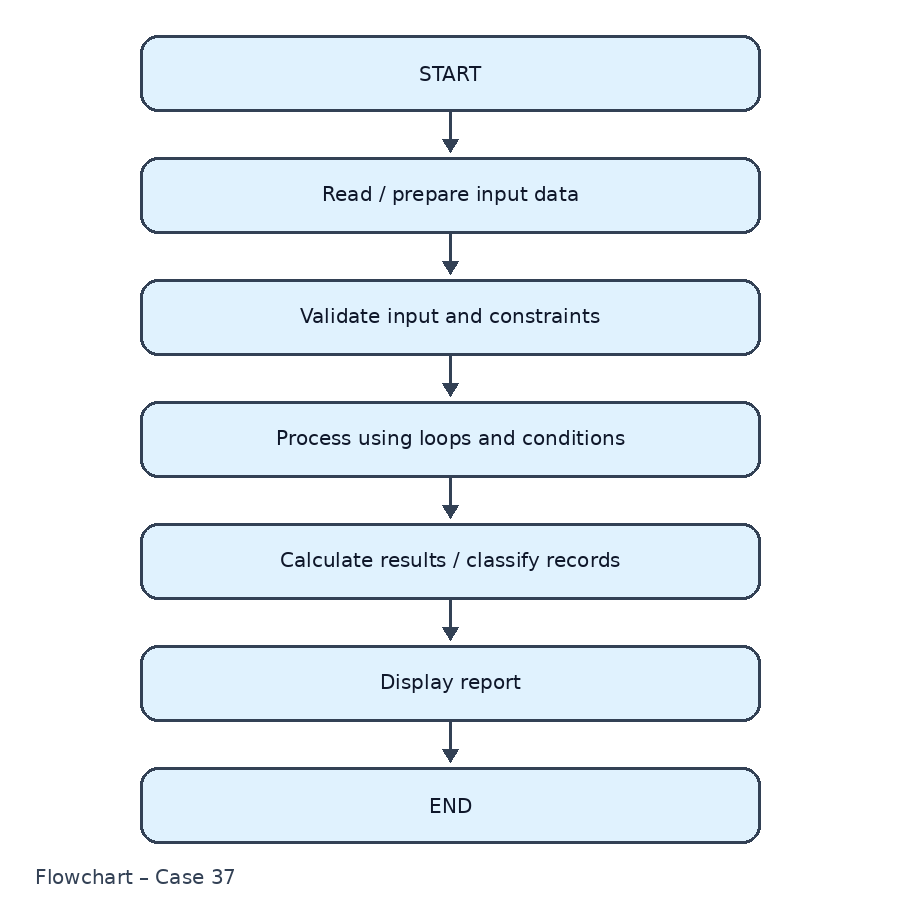
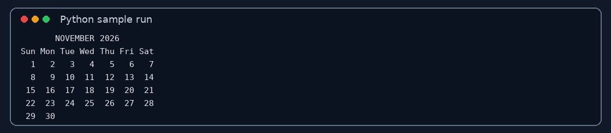

# Case Study 37: Nested Loop Calendar Generator

## 1. Problem Statement
Generate a formatted monthly calendar using a supplied starting weekday and number of days, aligning dates correctly into weeks.

## 2. Objectives
- Validate the number of days and starting weekday.
- Use nested loops to generate a calendar grid.
- Align dates under the correct weekday.

## 3. Assumptions
- Week starts on Sunday.
- Starting weekday is supplied as an integer: Sunday = 0 through Saturday = 6.
- Valid month lengths are 28, 29, 30, or 31 days.
- No month name or year calculation is required.

## 4. Algorithm
1. Read the month label, starting weekday, and number of days.
2. Validate the weekday and month length.
3. Print weekday headings.
4. Use a nested loop for six possible calendar weeks and seven weekdays.
5. Print blank cells before the first day and after the last day.
6. Stop when all dates have been printed.

## 5. Flowchart
The diagram below shows the overall program flow. Detailed case-specific decisions are implemented in `solution.py`.



## 6. Pseudocode
```text
START
READ month label, starting_weekday, number_of_days
VALIDATE weekday is 0..6 and days is 28..31
PRINT month label and weekday headings
SET day = 1
FOR week from 1 to 6
  FOR weekday from 0 to 6
    IF first-week leading blank OR day > number_of_days, PRINT blank cell
    ELSE PRINT day and increment day
  END FOR
  PRINT new line
  IF day > number_of_days, EXIT week loop
END FOR
STOP
```

## 7. Python Source Code
See [`solution.py`](solution.py). The program uses Python built-in features and no third-party packages.

## 8. Test Cases

| Test | Input / condition | Expected result |
|---|---|---|
| Month starts Sunday | Starting weekday 0, 30 days | Day 1 appears under Sunday |
| Month starts Wednesday | Starting weekday 3, 31 days | Three blank cells appear before day 1 |
| Leap-February layout | Starting weekday 0, 29 days | Calendar contains dates 1 through 29 |
| Invalid weekday | Starting weekday 7 | ValueError is raised |
| Invalid month length | Number of days 32 | ValueError is raised |

## Sample Output
The included program was run with the sample data in `main()`. The captured output is also saved as `sample_output.txt`.



## 9. Output Screenshot
This terminal-style screenshot is a generated capture of the sample program output. Run `python solution.py` to reproduce it.

## 10. Conclusion
The calendar generator aligns dates using nested loops and conditional checks. It demonstrates iteration, validation, formatted strings, and basic calendar-grid logic.
